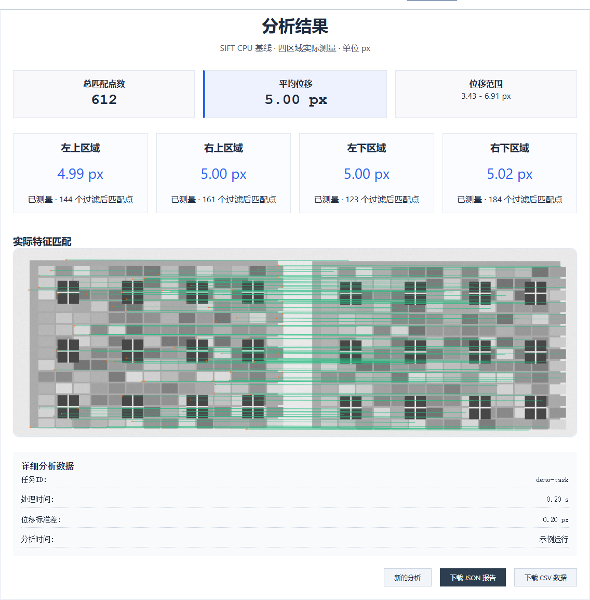
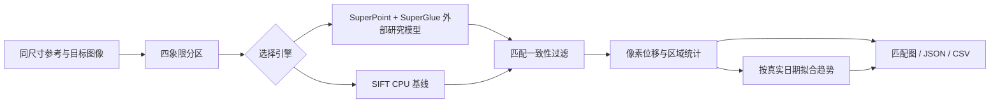

# 无靶标自建房变形监测系统

**House Deformation Monitoring · 图像配准与像素位移分析研究原型**

基于固定视角图像，使用 **SuperPoint + SuperGlue** 提取、匹配特征，并对建筑图像的四个区域分别计算像素位移；支持多日期图像对比与趋势分析。本仓库提供分析服务、Web 界面与可复现的合成示例。



> 图中为合成示例，使用 SIFT CPU 基线验证运行流程。它不是建筑实测数据，也不代表 SuperGlue 的评测精度。

## 可以做什么

- **单次区域分析**：参考图像与目标图像分为左上、右上、左下、右下四个区域，返回真实匹配点数、位移幅值与方向中位数。
- **时间序列分析**：上传基础图像与 1–20 张对比图像，按拍摄日期排序；每个区域至少三个有效对比日期才拟合趋势。
- **结果检查与导出**：查看实际匹配连线、各区域统计及日期曲线，下载 JSON 报告或 CSV 数据。
- **两种明确区分的引擎**：原项目 SuperPoint + SuperGlue 研究模型通过外部适配器接入；SIFT CPU 基线无需权重即可运行。
- **真实失败状态**：模型缺失返回明确错误，纹理不足显示缺失测量，不生成随机位移，也不把失败标成零位移。

## 快速运行

建议使用 Python 3.11–3.13，从源码目录运行。核心服务也已在当前本机 Python 3.14 环境验证；研究模型的 PyTorch 安装应与 Python 和设备匹配。

```powershell
python -m venv .venv
.\.venv\Scripts\python.exe -m pip install -r requirements.txt
.\.venv\Scripts\python.exe run.py
```

macOS / Linux 使用 `.venv/bin/python` 代替 `.venv\Scripts\python.exe`。启动后打开 [本地界面](http://127.0.0.1:8000)，点击 **「用合成示例试一试」**，可直接运行 SIFT 基线。

默认监听 `127.0.0.1:8000`；可通过 `python run.py --port 8080` 调整端口。前端由同一服务提供，无需另外打开 HTML 文件或配置跨域。

### 使用原研究模型

权重、第三方模型实现和训练数据未包含在本仓库。将 `.env.example` 复制为 `.env`，设置已有研究目录后，按 [模型接入说明](docs/models.md) 安装匹配的 PyTorch，再选择 **SuperPoint + SuperGlue · 研究模型**。

当前适配器面向原项目的训练版 SuperGlue 接口，不能直接替换为任意同名上游文件。首次推理会验证源码和权重；配置检查通过不等于模型已经成功加载。

## 项目结构

```text
house-deformation-monitoring/
├── backend/
│   ├── app.py                  # FastAPI、上传校验、报告与静态界面
│   ├── config.py               # 路径与环境配置
│   ├── analysis.py             # 四区域统计、真实日期趋势
│   ├── matching.py             # 匹配接口、SIFT CPU 基线
│   └── superglue_adapter.py    # 外部研究模型适配器
├── frontend/                   # 保留原界面结构的 HTML / CSS / JS
├── examples/                   # 可复现的合成平移图片
├── research/                   # 研究版本与实验入口索引
├── scripts/make_examples.py     # 示例生成脚本
├── tests/                      # 算法与 API 回归测试
├── docs/                       # 设计、接口、迁移、验证与预览
├── .github/workflows/test.yml   # 提交后的 CI 检查配置
├── .env.example
├── requirements.txt
└── run.py                      # 统一启动入口
```

运行报告保存在 `var/<task_id>/`，原始上传图像只用于本次处理。`var/`、`.env`、虚拟环境、外部模型、权重和私人资料均在 `.gitignore` 中排除。

## 数据流程



## 指标与适用范围

位移向量为 `目标坐标 - 参考坐标`，单位 **px**；平均位移为全部有效匹配点的向量模长均值，而不是四个区域均值的简单平均。区域内过滤后少于 6 个匹配点时，该区域不参与位移统计。

当前未实现物理尺度标定、相机运动补偿、四区域仿射一致性判据或工程级安全评估。相机移动、视角变化、光照与误匹配均可能影响输出。趋势提示描述像素位移幅值随时间的变化，不能直接解释为房屋真实形变、毫米级精度或安全结论。

原材料中提到的裂缝诊断、全天候在线采集、云边协同等属于研究目标或后续方向，本整理版没有将其列为已实现功能。LightGlue 保留为实验索引，未接入当前 Web 服务。

## 验证

```powershell
python -m pip install -r requirements-dev.txt
python -m unittest discover -s tests -v
```

当前本机 Python 3.14 与全新 Python 3.12 环境各通过 11 项自动化测试；另完成桌面 / 390px 移动视口交互检查，以及一次本地 SuperGlue 权重实际推理。验证数据、已验证环境与限制见 [验证记录](docs/validation.md)。CI 配置尚未在 GitHub 运行。

## 文档

- [安装与日常使用](docs/quickstart.md)
- [系统设计与算法说明](docs/architecture.md)
- [API 接口](docs/api.md)
- [原模型配置与权重清单](docs/models.md)
- [实验与历史版本索引](research/README.md)
- [第三方来源与许可边界](THIRD_PARTY_NOTICES.md)
- [源码发布范围](docs/privacy.md)

## 代码使用与第三方依赖

本仓库尚未指定统一的开源许可证。外部模型、权重和第三方依赖适用各自的许可要求，详见 [第三方说明](THIRD_PARTY_NOTICES.md)。
